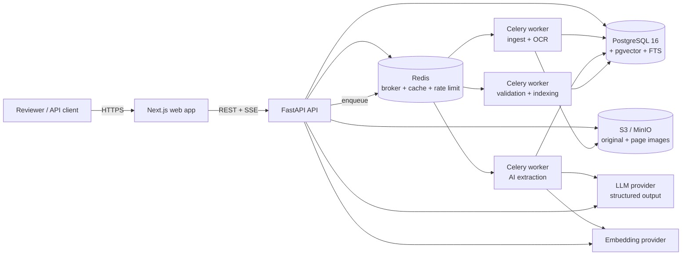
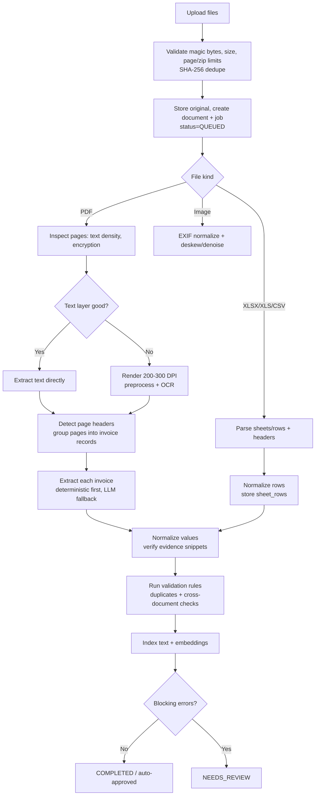
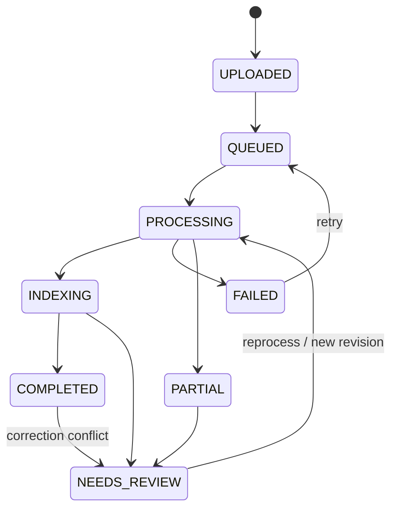
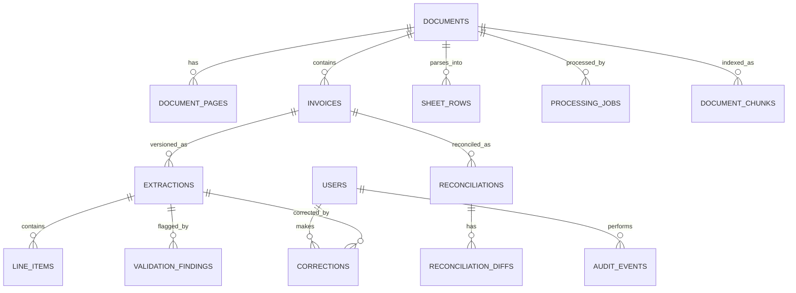

# AI-Powered Document Intelligence System — Execution Plan

**Role:** AI Engineer (solo, 5-day take-home)
**Status:** Plan v1.0
**Working name:** DocIntel
**Deliverable target:** A running, tested, evaluated system + docs + walkthrough video within 5 days.

---

## 1. Plan at a glance

| Area | Decision |
| --- | --- |
| Backend | Python 3.12 + FastAPI, SQLAlchemy 2.0, Alembic, Pydantic v2 |
| Async processing | Celery + Redis (separate queues for OCR, extraction, indexing) |
| Database | PostgreSQL 16 + pgvector + full-text search + pg_trgm |
| Object storage | S3-compatible (MinIO locally) behind a storage interface |
| OCR | PyMuPDF for PDF text/rendering + Tesseract 5; OpenCV preprocessing |
| Spreadsheets | pandas + openpyxl (XLSX), xlrd (XLS), csv + charset-normalizer |
| AI extraction | Provider-agnostic LLM client, JSON-schema structured output, evidence verification, deterministic-first fallback |
| Frontend | Next.js 15 (App Router) + TypeScript + Tailwind + shadcn/ui + TanStack Query + PDF.js |
| Testing | pytest, testcontainers, Playwright, Locust/k6, recorded LLM cassettes |
| Deployment | Docker Compose one-command local demo; optional cloud deploy |
| Demo data | Synthetic labeled invoices + degraded scans + spreadsheets + corrupt files |
| Scope strategy | Thin end-to-end first, then harden and evaluate; all 7 tasks covered |

**Core engineering bet:** treat extraction as an *evidence-backed* problem, not a prompt-only problem. Every extracted value must either be supported by a verbatim source snippet or be explicitly null/low-confidence. This is how we prevent invented values and make manual review trustworthy.

---

## 2. Goals, non-goals, and acceptance criteria

### 2.1 Functional goals (mapped to the assignment)

| Task | Acceptance criterion |
| --- | --- |
| 1. Document processing | Accept PDF, JPG, PNG, TIFF, XLSX, XLS, CSV. Digital PDF text extracted without OCR; scanned/image files OCR'd; spreadsheets parsed with sheets and headers; multi-page and multi-sheet supported; corrupt/encrypted/oversized files fail gracefully with actionable errors. |
| 2. AI extraction | Structured JSON for invoice number, date, supplier, customer, subtotal, tax, total, currency, line items. Missing fields are `null` with a reason; every non-null value carries confidence + evidence; no invented values. |
| 3. Validation | Missing-field, arithmetic, duplicate, and cross-document checks. Findings have severity and are linked to fields. Records that fail blocking rules are marked `needs_review`. |
| 4. Backend API | Upload, status, results, search, corrections, retry/reprocess. OCR and AI run in background workers. API documented via OpenAPI. |
| 5. Database + search | Metadata, raw text, structured results, findings, history, revisions and audit trail persisted. Keyword, structured, and semantic search. |
| 6. Frontend | Multi-file upload, live processing progress, document inspection (source + fields side by side), validation review, inline corrections, search. |
| 7. Testing + evaluation | Automated unit/integration/e2e/load/security tests. Evaluation run on a labeled dataset with measured accuracy, processing time, success and failure rates. |

### 2.2 Engineering quality bars (targets, measured on Day 5)

These are **goals to validate**, not pre-reported results:

- Field-level F1 ≥ 0.95 on clean digital invoices; ≥ 0.80 on scanned/degraded invoices.
- Abstention accuracy ≥ 0.90 on fields intentionally absent from the source.
- Arithmetic + duplicate rule recall ≥ 0.95 on injected-error fixtures; auto-approval precision ≥ 0.98.
- Supported-file success rate ≥ 98%; 100% graceful handling of corrupt/unsupported files (no crash, clear error).
- Metadata API p95 < 300 ms; hybrid search p95 < 800 ms locally.
- One-page digital invoice end-to-end p95 < 20 s; scanned < 40 s.
- 1000-page PDF processed with progress, bounded memory, and < 15 min with 4 OCR workers (target; measured, not assumed).
- Backend core test coverage ≥ 80%; all tests deterministic (no live LLM calls in CI).

### 2.3 Non-goals (explicitly out of scope for 5 days)

- Full accounting/ERP integration, e-invoicing standards (UBL/ZUGFeRD), e-signatures.
- SSO/multi-tenancy, mobile app, real-time multi-user collaboration.
- Training a custom OCR or extraction model.
- Auto-posting corrected data to external systems.
- Password-protected PDFs (detected and reported; not cracked).

---

## 3. Assumptions and decisions to confirm

1. **LLM access:** an API key is available. The system also ships a deterministic fallback extractor so the demo and tests work without a key. Recommended default: a small, fast multimodal-capable model (e.g., GPT-4o-mini class or Gemini Flash class) via a provider abstraction. Final provider to be confirmed.
2. **Language/currency:** English documents, multi-currency supported (ISO 4217), single currency per invoice.
3. **1000-page PDFs are bundles:** they may contain many invoices; the design groups pages into logical invoice records. A single giant 1000-page invoice is also supported (one group).
4. **Demo environment:** local Docker Compose is the primary target. Optional public deployment only if time allows.
5. **Auth scope:** email/password with JWT, roles `admin` / `reviewer` / `viewer`. Full identity provider integration is out of scope.
6. **Data:** synthetic + public data only unless real samples are provided. No PII leaves the machine except text sent to the configured LLM provider (documented, with a local-only mode).
7. **Storage:** object storage interface with MinIO/S3 in Docker; local filesystem adapter for quick tests.

If any assumption is wrong (especially LLM provider, access to sample documents, or expected deployment), confirm before Day 1 implementation.

---

## 4. Architecture

### 4.1 High-level architecture



**Component responsibilities**

- **API (FastAPI):** auth, upload, validation of uploads, CRUD, search, corrections, SSE progress, OpenAPI. Stateless; safe to scale horizontally.
- **Workers (Celery):** page rendering/OCR, extraction, validation, embedding/indexing, reconciliation. Isolated queues; retries and time limits per stage.
- **PostgreSQL:** source of truth for metadata, text, results, findings, revisions, jobs, vectors and search indexes.
- **Redis:** Celery broker/result backend, cache, rate limits, pub/sub for progress.
- **Object storage:** immutable originals + derived page images/previews. The DB stores only keys.
- **LLM provider:** structured extraction and embeddings, behind interfaces with timeouts, retries, budgeting and a fake implementation for tests.

### 4.2 Processing pipeline



**Document status state machine**



Statuses are stored at both file level (`documents`) and logical invoice level (`invoices`). A bundle is `NEEDS_REVIEW` if any contained invoice needs review. Progress is tracked as pages done / total and invoices done / total.

### 4.3 Key pipeline decisions

- **Digital-first:** if PyMuPDF finds a quality text layer, skip OCR for that page (huge speed win on 1000-page PDFs).
- **Page-level isolation:** each page is processed independently; a single bad page does not fail the whole file. Per-page errors are recorded.
- **Chunked fan-out:** PDFs are processed in page chunks (e.g., 10 pages/task) to bound memory and task overhead; progress is aggregated in the DB.
- **Logical invoice grouping:** a 1000-page PDF is split into invoice units using invoice number + supplier + page continuation heuristics. Groups with ambiguous boundaries are flagged for review; merge/split is a P1 feature.
- **Deterministic-first extraction:** regex/layout parsers handle invoice number, dates, amounts, currency and totals when confident; the LLM handles layout variation, line items and ambiguous fields. This reduces cost and latency.
- **Bounded LLM spend:** max pages per extraction, max calls per document, text-hash cache keyed by prompt version, and a hard per-document budget guard.
- **Fail isolated, report clearly:** corrupt/encrypted/unsupported files produce a `FAILED` job with a stable error code and human-readable message; the batch continues.

---

## 5. AI information extraction design

### 5.1 Output contract (stored JSONB, versioned)

Money is represented as decimal **strings** in JSON to avoid floating-point errors; the backend parses to `Decimal`.

```json
{
  "schema_version": "1.0",
  "document_type": "invoice",
  "invoice_number": {
    "value": "INV-2024-0042",
    "confidence": 0.97,
    "evidence": { "page": 1, "quote": "Invoice No: INV-2024-0042" }
  },
  "invoice_date": {
    "value": "2024-03-15",
    "confidence": 0.95,
    "evidence": { "page": 1, "quote": "Date: 15/03/2024" }
  },
  "supplier": {
    "name": { "value": "Acme Components Ltd", "confidence": 0.96, "evidence": { "page": 1, "quote": "Acme Components Ltd" } },
    "tax_id": { "value": "GB123456789", "confidence": 0.9, "evidence": { "page": 1, "quote": "VAT: GB123456789" } },
    "address": { "value": "12 King Street, Leeds", "confidence": 0.88, "evidence": { "page": 1, "quote": "12 King Street, Leeds" } }
  },
  "customer": {
    "name": { "value": "Northwind Traders", "confidence": 0.94, "evidence": { "page": 1, "quote": "Bill To: Northwind Traders" } }
  },
  "currency": { "value": "GBP", "confidence": 0.99, "evidence": { "page": 1, "quote": "£" } },
  "subtotal": { "value": "1250.00", "confidence": 0.93, "evidence": { "page": 1, "quote": "Subtotal 1,250.00" } },
  "tax": { "value": "250.00", "confidence": 0.93, "evidence": { "page": 1, "quote": "VAT 20% 250.00" } },
  "total": { "value": "1500.00", "confidence": 0.97, "evidence": { "page": 1, "quote": "Total Due 1,500.00" } },
  "line_items": [
    {
      "description": "Steel bracket A2",
      "quantity": "2",
      "unit_price": "625.00",
      "amount": "1250.00",
      "tax_rate": "20",
      "confidence": 0.9,
      "page": 1
    }
  ],
  "warnings": []
}
```

Missing field convention:

```json
"tax": { "value": null, "confidence": 0.0, "reason": "not present in source" }
```

Rules:

- The LLM may **never** compute a missing value. Arithmetic suggestions belong in validation findings, not extraction.
- Every non-null field must include a verbatim quote. The backend normalizes whitespace and **verifies the quote exists on the cited page**; unsupported fields are flagged (`EVIDENCE_UNVERIFIED`), confidence is reduced, and the record goes to review.
- Dates normalized to ISO `YYYY-MM-DD`; currencies to ISO 4217; amounts to `Decimal` with the invoice currency precision.
- Confidence rubric in the prompt: 0.95+ explicit label + clean text; 0.8–0.95 explicit but noisy/OCR; 0.5–0.8 inferred from context; <0.5 ambiguous. Null when absent.

### 5.2 Prompt and call strategy

- **Prompt files versioned in repo** (`prompts/extract_invoice.v1.md`, `prompts/group_pages.v1.md`, `prompts/verify_fields.v1.md`). Prompt version is stored with every extraction for reproducibility.
- **Structured output enforced** by JSON Schema / function calling; invalid responses are repaired once, then fail to a retry/review path. Temperature 0.
- **Untrusted text delimiting:** document content is wrapped in explicit data delimiters with instructions to ignore any instructions inside it. The LLM has no tools and cannot mutate state.
- **Two-stage optional verification:** for low-confidence or high-value fields, a cheap verifier prompt receives the page text and proposed values and answers whether each is supported. This is a quality lever, not a second source of truth.
- **Per-invoice calls**, concurrency-limited (e.g., 8 in flight), with timeouts, retries on 429/5xx (exponential backoff + jitter), and a circuit breaker.
- **Caching:** SHA-256 of normalized input text + prompt version + model → extraction cache. Safe for identical re-runs and tests.
- **Fallback:** deterministic extractor (labels/regex + table parsing) and a clear `AI_UNAVAILABLE` warning if the provider fails; processing still completes with lower confidence and review flag.
- **Text size control:** send only the invoice group's pages, trim boilerplate, cap tokens; for long groups, summarize tables deterministically and send relevant sections. Never send 1000 pages in one call.
- **Cost guard:** per-document call/token budget; excess invoices are queued with `BUDGET_EXCEEDED` and marked for review instead of silently dropped.

### 5.3 AI-assisted development disclosure (deliverable 9)

- Maintain `docs/ai-disclosure.md` listing tools used (e.g., ChatGPT/Claude/Copilot/OpenCode), what they helped with (scaffolding, tests, debugging, docs), and confirmation that all generated code was reviewed and tested.
- Include the actual production prompts in `prompts/` and a short prompt-engineering rationale in the README.
- Never commit API keys, real invoices, or personal data. Use `.env.example` and synthetic fixtures.

---

## 6. Validation and reconciliation

### 6.1 Rule catalog

Findings are persisted with `rule_code`, `severity` (`info` / `warning` / `error`), `field_path`, `message`, `expected`, `actual`, and `blocks_auto_approval`.

| Code | Check | Severity | Auto-approval |
| --- | --- | --- | --- |
| V001 | Required fields: invoice number, date, supplier, total, currency | error | block |
| V002 | Date parses; not in future; not older than configurable window | error/warn | block on invalid |
| V003 | Amounts parse as decimal; non-negative (credit notes handled explicitly) | error | block |
| V004 | subtotal + tax = total, tolerance 0.01 or configured rounding | error | block |
| V005 | sum(line items) = subtotal, tolerance max(0.02, 0.5%) | error | block |
| V006 | quantity × unit_price = line amount | warning | no (but reviewed) |
| V007 | Tax rate plausible (0–35%); tax ≈ subtotal × rate when rate present | warning | no |
| V008 | Currency is ISO 4217 and matches symbol/text hints | error/warn | block on invalid |
| V009 | Total is present but line items missing above threshold | warning | review |
| V010 | Duplicate: normalized supplier + invoice number already exists | error | block |
| V011 | Near-duplicate: fuzzy supplier, same/±1 day, total within tolerance, number similarity | warning | review |
| V012 | PDF vs PDF: same invoice found with conflicting financial values | error | block |
| V013 | PDF vs spreadsheet row: amounts/date/tax mismatch | error/warn | block on financial mismatch |
| V014 | Spreadsheet internal row totals inconsistent | warning/error | review |
| V015 | Low OCR or extraction confidence below threshold | warning | review |
| V016 | Unverified evidence quote for a non-null field | warning | review |
| V017 | Suspected prompt-injection content detected in source | warning | review |

Normalization for matching: uppercase, strip punctuation/whitespace, strip common prefixes (`INV`, `#`), zero-pad-insensitive comparison, supplier fuzzy match with RapidFuzz token-set ratio ≥ 90, money tolerance 0.01, date tolerance 0 days for duplicates.

### 6.2 Cross-document verification

- **PDF ↔ PDF:** compare logical invoices sharing a normalized invoice number + supplier; also detect near-duplicates via fuzzy fingerprint (supplier, date, total, line item descriptions). Produce a `reconciliation` record with field-level diffs.
- **PDF ↔ Excel/CSV:** spreadsheet rows are parsed into `sheet_rows` with detected header mapping (invoice number, date, supplier, subtotal, tax, total, currency). For each invoice, find candidate rows by invoice number + supplier; if none, fuzzy match on amount + date + supplier. Compare fields and store diffs.
- **Triggers:** automatically on invoice completion (look up counterparts), plus a manual `POST /reconciliations/run` for selected documents/batches.
- **UI:** "Matched document" panel with side-by-side values and a link to each source; reviewer can accept the match or mark it false-positive (stored for audit).
- Never auto-correct either side. Diffs are findings; the reviewer decides.

### 6.3 Review workflow

- A record is auto-approved only when all required fields exist with confidence ≥ threshold, evidence is verified, and no blocking findings exist.
- Reviewers can edit fields, line items, and match decisions. Each edit creates a **new immutable extraction revision** (source=`manual`) linked to the prior revision; validation re-runs; the audit trail is preserved.
- Findings can be resolved/dismissed with a reason and user ID.
- "Approve" marks the revision as reviewed; "Reopen" creates a new draft revision for further edits.
- Concurrency: optimistic locking via extraction `version` / `If-Match`; conflicting edits return `409`.

---

## 7. Database design

### 7.1 Entity relationship diagram



### 7.2 Tables and key columns

| Table | Purpose | Key fields / indexes |
| --- | --- | --- |
| `users` | Auth + roles | `id`, `email` unique, `password_hash`, `role`, `is_active`, timestamps |
| `documents` | Physical uploaded file | `id` uuid, `original_filename`, `mime_type`, `size_bytes`, `sha256` unique, `storage_key`, `kind` (`pdf`/`image`/`spreadsheet`), `status`, `stage`, `page_count`, `progress` jsonb, `error_code`, `error_message`, `uploaded_by`, timestamps. Indexes: `(status, created_at)`, `sha256`, `kind`. |
| `document_pages` | Page text + OCR metadata | `id`, `document_id`, `page_number`, `text`, `text_source` (`digital`/`ocr`), `ocr_confidence`, `image_key`, `width`, `height`, `error`, unique `(document_id, page_number)` |
| `invoices` | Logical invoice units inside a file | `id`, `document_id`, `page_start`, `page_end`, `status`, `invoice_number_norm`, `supplier_norm`, `current_extraction_id`, `grouping_confidence`, timestamps. Indexes: `(document_id)`, `(invoice_number_norm, supplier_norm)` |
| `extractions` | Immutable extraction revisions | `id`, `invoice_id`, `version`, `schema_version`, `prompt_version`, `model`, `source` (`ai`/`manual`/`fallback`), `data` jsonb, `field_confidence` jsonb, `is_current`, `review_status`, `reviewed_by`, timestamps. Unique `(invoice_id, version)`; partial unique index on current revision. GIN on `data` for structured search. |
| `line_items` | Queryable line items | `id`, `extraction_id`, `line_no`, `description`, `quantity` numeric, `unit_price` numeric, `amount` numeric, `tax_rate` numeric, `confidence`, `page` |
| `validation_findings` | Rule results | `id`, `extraction_id`, `invoice_id`, `document_id`, `rule_code`, `severity`, `field_path`, `message`, `expected`, `actual`, `status` (`open`/`resolved`/`dismissed`), `resolved_by`, `resolved_at`, `resolution_note`. Indexes: `(document_id, status)`, `(rule_code)` |
| `corrections` | Field-level audit trail | `id`, `extraction_id`, `user_id`, `field_path`, `old_value` jsonb, `new_value` jsonb, `reason`, `created_at` |
| `processing_jobs` | Durable job/status history | `id`, `document_id`, `stage`, `queue`, `status`, `attempts`, `max_attempts`, `idempotency_key` unique, `celery_task_id`, `error_code`, `error_message`, `metrics` jsonb, `queued_at`, `started_at`, `finished_at` |
| `sheet_rows` | Parsed spreadsheet rows | `id`, `document_id`, `sheet_name`, `row_number`, `data` jsonb, `normalized` jsonb, `parse_warnings` jsonb. Indexes: `(document_id, sheet_name)`, GIN on `normalized`. |
| `reconciliations` | Cross-document match | `id`, `invoice_id`, `matched_document_id`, `matched_sheet_row_id`, `match_type` (`pdf_pdf`/`pdf_sheet`), `confidence`, `status`, timestamps |
| `reconciliation_diffs` | Field differences | `id`, `reconciliation_id`, `field_path`, `left_value` jsonb, `right_value` jsonb, `severity`, `resolution` |
| `document_chunks` | Search + vector index | `id`, `document_id`, `page_id`, `invoice_id`, `chunk_index`, `content`, `tsv tsvector`, `embedding vector(1536)`, `metadata` jsonb. Indexes: GIN `tsv`, HNSW `embedding vector_cosine_ops`, `(document_id)` |
| `audit_events` | Security/audit trail | `id`, `user_id`, `action`, `entity_type`, `entity_id`, `metadata` jsonb, `ip`, `created_at` |

### 7.3 Data rules

- Money stored as `NUMERIC(18,4)`; raw source strings kept in extraction JSON.
- Original extraction JSON is immutable; corrections create a new revision.
- Soft delete for documents (status + `deleted_at`) with configurable retention; hard purge job for storage objects.
- Every status transition and review action writes an `audit_event`.
- Migrations via Alembic; seed script creates demo users, suppliers and fixture data.
- Timestamps UTC; API returns ISO 8601.

---

## 8. Backend API

### 8.1 Conventions

- Base path `/api/v1`; OpenAPI at `/docs`; health at `/health/live` and `/health/ready`.
- JSON errors follow RFC 7807 (`application/problem+json`) with `type`, `title`, `status`, `detail`, `code`, `request_id`.
- Auth: JWT bearer (15 min access, 7 day refresh). Web app stores tokens in `HttpOnly`, `SameSite=Lax` cookies and sends a CSRF token header for mutations. Roles: `admin`, `reviewer`, `viewer`.
- Upload uses `multipart/form-data`; `Idempotency-Key` header optional; duplicate SHA-256 returns the existing document with `409` semantics or a `duplicate: true` field (decided: return `200` with existing document).
- Pagination: `limit` (max 100) + `cursor`; filtering/sorting explicitly allowed.
- All endpoints documented with request/response examples; OpenAPI exported to `docs/openapi.json` in CI.

### 8.2 Endpoint surface

| Method | Path | Purpose |
| --- | --- | --- |
| POST | `/auth/login` | Get access/refresh tokens |
| POST | `/auth/refresh` | Rotate access token |
| POST | `/auth/logout` | Revoke refresh session |
| POST | `/documents` | Upload 1–20 files; returns `202` with document IDs |
| GET | `/documents` | List/filter: status, kind, supplier, date range, amount range, q |
| GET | `/documents/{id}` | Metadata + latest invoice/extraction + findings summary |
| GET | `/documents/{id}/status` | Lightweight polling: status, stage, progress, job errors |
| GET | `/documents/{id}/events` | SSE progress stream (fallback: polling) |
| GET | `/documents/{id}/file` | Short-lived signed download of original |
| GET | `/documents/{id}/pages/{n}/image` | Signed page preview |
| GET | `/documents/{id}/text` | Extracted text by page (paginated) |
| GET | `/documents/{id}/invoices` | Logical invoice units + page ranges |
| GET | `/invoices/{id}` | Invoice detail + current extraction |
| GET | `/invoices/{id}/extractions` | Revision history |
| PATCH | `/invoices/{id}/extractions/{eid}` | Apply field/line-item corrections (new revision, `If-Match`) |
| POST | `/invoices/{id}/review` | Approve / reopen with note |
| GET | `/documents/{id}/findings` | Validation findings |
| PATCH | `/findings/{id}` | Resolve/dismiss with reason |
| POST | `/documents/{id}/reprocess` | Re-run selected stages (`ocr`, `extract`, `validate`, `all`) |
| GET | `/jobs/{id}` | Job status/history |
| POST | `/jobs/{id}/retry` | Retry failed job (max attempts enforced) |
| GET | `/search` | Keyword/structured/semantic/hybrid search |
| POST | `/reconciliations/run` | Cross-verify selected docs/batch |
| GET | `/reconciliations` | List matches and diffs |
| GET | `/dashboard/stats` | Counts, review rate, success/failure, processing times |
| GET | `/admin/health/queues` | Queue depths and stuck jobs (admin) |

### 8.3 Upload response example

```json
{
  "documents": [
    { "id": "a3f1...", "original_filename": "invoices_march.pdf", "status": "queued", "duplicate": false },
    { "id": "b7c2...", "original_filename": "ledger.xlsx", "status": "queued", "duplicate": false }
  ],
  "rejected": [
    { "filename": "broken.pdf", "code": "INVALID_PDF", "message": "File is encrypted and cannot be processed" }
  ]
}
```

### 8.4 Background job semantics

- Upload endpoint only validates and enqueues; it never blocks on OCR/AI.
- Celery queues: `ingest`, `ocr`, `ai`, `validate`, `index`, `reconcile`; routing per task.
- Retries: max 3, exponential backoff (2^n seconds + jitter), only for transient errors (timeouts, 429/5xx, DB deadlocks). Validation errors and corrupt files are not retried blindly.
- Idempotency: `(document_sha256, stage, prompt_version)` key; duplicate task deliveries are safe (unique constraint + upsert).
- Stuck-job reaper: periodic task requeues jobs with an expired heartbeat (visibility timeout), max 2 requeues.
- Cancellation: delete/reprocess sets a cancellation flag checked between page chunks.
- Progress updates are batched (every chunk / 5 pages) to avoid DB write storms.

---

## 9. Search design

Three modes, one endpoint (`GET /search?q=&mode=`):

1. **Keyword / full-text:** PostgreSQL `websearch_to_tsquery` over page text and invoice chunks; trigram similarity fallback for supplier and invoice numbers; snippet highlighting via `ts_headline`.
2. **Structured filters:** supplier, status, document kind, date range, amount range, currency, has-validation-errors, review status. Backed by B-tree + GIN indexes on normalized fields and extraction JSONB.
3. **Semantic:** chunk text (≈800 tokens, 120 overlap), embed with a configurable model, store in pgvector with an HNSW index (cosine). Query embedding + top-k per document; optional MMR-style diversity by page.
4. **Hybrid:** reciprocal rank fusion (RRF, k=60) of FTS and vector rankings, then apply filters. Default mode `hybrid`; falls back to keyword if embeddings are unavailable.
5. **Indexing pipeline:** on completion, build chunks (invoice header summary, line-item table text, page text), embed in batches, upsert; re-index on correction. Record `embedding_model` and `chunk_version` for reproducibility.
6. **Quality:** evaluation includes 20 hand-written queries with expected document/page IDs; report Recall@10 and MRR. Avoid claiming semantic quality without measurements.

---

## 10. Frontend

### 10.1 Routes

- `/login` — seeded demo credentials.
- `/upload` — drag-and-drop multi-file upload, per-file progress, rejection reasons, recent uploads.
- `/documents` — filterable/paginated table: filename, kind, status, supplier, invoice number, total, confidence, findings, created date; bulk actions (reprocess, reconcile).
- `/documents/[id]` — the primary review workspace:
  - Left: PDF.js viewer with page navigation/thumbnails; images rendered directly; spreadsheet table view with sheet tabs.
  - Right: extracted fields form with confidence badges, evidence quotes, null markers, validation findings linked to fields.
  - Line-item editor with add/remove; live arithmetic hints (display-only until saved).
  - Actions: save revision, approve, reopen, reprocess, download original, view matched documents.
  - Progress view while processing (stage + pages done + live updates via SSE/polling).
- `/search` — keyword/semantic toggle, filters, result snippets, jump to page/field.
- `/dashboard` — volumes, status breakdown, review rate, success/failure, p50/p95, queue depth (read-only).
- `/jobs` — failed jobs with error codes and retry buttons (admin/reviewer).

### 10.2 UX and implementation details

- TanStack Query for caching, polling fallback, optimistic correction updates, invalidation.
- SSE for live progress when available; polling every 2–3 s otherwise.
- PDF.js page virtualization; render at moderate DPI; thumbnails lazy-loaded.
- Evidence highlight: locate the quote in page text and highlight; if a bounding box is unavailable, show the quote in a side panel (avoid fake overlays).
- Confidence chips: green ≥ 0.9, amber 0.7–0.9, red < 0.7; null fields clearly marked, never prefilled with guesses.
- Accessible forms (labels, keyboard navigation), responsive layout (stacked on mobile), clear empty/error/loading states.
- Frontend tests: component tests for field editor and validation panel; Playwright e2e for the core review flow.

---

## 11. Performance, scalability, reliability

### 11.1 Performance plan

- **No OCR when unnecessary:** digital text density check per page; OCR only scanned pages.
- **Parallelism:** Celery concurrency per queue; page chunks processed in parallel; LLM calls concurrency-limited (separate semaphore) to respect provider limits.
- **Memory:** lazy page iteration with PyMuPDF; never load a 1000-page PDF into a Python list of images; write page images to disk/object storage and release.
- **Caching:** OCR page cache keyed by page image hash; extraction cache keyed by normalized text + prompt; embedding cache keyed by chunk hash.
- **DB efficiency:** bulk inserts, `COPY` for large row sets if needed, connection pooling, pagination, covering indexes; avoid N+1 in list endpoints.
- **Embeddings:** batch (32–64 chunks), retry with backoff; keep indexing off the critical extraction path.
- **API latency:** status endpoint served from a small `documents` row; heavy JSON only on detail endpoints.
- **Load test:** 100 concurrent uploads and a 1000-page bundle; report p50/p95, throughput, queue depth, error rate.
- **Budget guard:** per-document LLM token/call cap; surface `BUDGET_EXCEEDED` in UI.

### 11.2 Scalability

- Stateless API → horizontal scaling behind a load balancer.
- Independent worker pools: OCR is CPU/memory-heavy; AI is network-bound; validation/indexing is DB-bound. Scale separately.
- Redis broker + Postgres are the shared services; use managed versions in production.
- Partition large tables (`document_pages`, `document_chunks`, `audit_events`) by time or document hash if volume grows; start with proper indexes and measure before partitioning.
- Pagination/cursors everywhere; no unbounded list endpoints.
- Multi-tenant extension path: add `tenant_id` to documents and row-level security (not implemented in 5 days; documented).

### 11.3 Reliability

- At-least-once processing + idempotent stages + unique constraints.
- Retry transient failures only; permanent failures go to a dead-letter state with actionable error codes.
- Per-page error isolation; `PARTIAL` status when some pages fail.
- Job heartbeat + stuck-job reaper; graceful worker shutdown on SIGTERM (finish current chunk, requeue rest).
- DB migrations gated in CI; backups/restore procedure documented for production.
- Health checks: API liveness, DB/Redis/object-store readiness; queue-depth metric; `/metrics` Prometheus endpoint.
- Structured logs with `request_id`, `document_id`, `job_id`, `stage`; never log raw document text or secrets.

### 11.4 Security

- **Upload security:** allowlist by extension + magic bytes; max 200 MB/file and 20 files/request; max 1,500 pages/PDF; XLSX zip-bomb guards; reject macros and executables; optional ClamAV scan hook; sanitize filenames; store outside web root.
- **Processing safety:** no shell string interpolation (argument lists only); subprocess timeouts and memory limits; PDFs opened without executing JavaScript; spreadsheets read with `read_only=True`, formulas never evaluated by our code; no external URL fetching (SSRF avoidance).
- **Auth/RBAC:** JWT with short expiry, hashed passwords (Argon2/bcrypt), role checks per endpoint, refresh rotation, logout revocation. Demo credentials documented and forced change in production.
- **Data protection:** signed short-lived URLs; encryption at rest via S3/volume; TLS in production; secrets only via environment/secret manager; PII redaction option for logs; configurable retention/purge.
- **LLM privacy:** provider data-retention settings documented; optional local model mode; no real PII in fixtures; document text is untrusted and schema-constrained.
- **Prompt injection:** delimit data, instruct the model to ignore embedded commands, no tools, validate output schema, detect suspicious phrases, flag for review. No extracted value can trigger actions.
- **Web security:** strict CORS allowlist, CSP, XSS-safe rendering (React escaping; no `dangerouslySetInnerHTML` on extracted text), CSRF protection for cookie auth, rate limiting on auth/upload/search, request size limits.
- **Supply chain:** lockfiles, `pip-audit` + `npm audit` in CI, Dependabot optional, non-root containers, pinned base images.
- **Audit:** login, upload, correction, approval, reprocess, export, role changes.

---

## 12. Testing strategy

### 12.1 Test pyramid

| Layer | Tools | Coverage |
| --- | --- | --- |
| Unit | pytest | mime/magic validation, page routing, OCR wrapper, spreadsheet header detection, normalization, JSON schema validation, evidence verification, every validation rule, RRF, chunking |
| Integration | pytest + testcontainers (Postgres, Redis, MinIO) + httpx | upload → worker → extraction (fake LLM) → validation → search; auth/RBAC; corrections create revisions; retry; duplicate upload; signed URLs; SSE |
| Contract | Schemathesis or OpenAPI checks | endpoint schemas and error formats |
| E2E | Playwright | login, multi-upload, progress, inspect, correct, approve, search, retry failed job |
| Failure | pytest fixtures | corrupt/encrypted/zero-byte PDF, wrong extension/magic byte, zip bomb, oversized file, blank OCR, malformed LLM JSON, LLM timeout/429, DB constraint conflict, worker crash/requeue |
| Performance | Locust/k6 + timing harness | 100 docs concurrently; 1000-page bundle; p50/p95, pages/min, memory ceiling |
| Security | pytest + manual checks | path traversal, SQLi in search, XSS payload in extracted text, prompt injection document, unauthorized access, rate limits |
| LLM determinism | vcrpy/recorded fixtures | replay realistic provider responses; tests never call the live API |

### 12.2 Test data

- Synthetic invoice generator (ReportLab + Faker, fixed seed) with varied layouts, currencies, taxes, missing fields, arithmetic errors, duplicates, and multi-page invoices.
- Degraded versions: rotated ±2–5°, blur, noise, JPEG compression, low DPI, photocopy effect — for OCR evaluation.
- Spreadsheets: multi-sheet XLSX, legacy XLS, CSV with different delimiters/encodings, merged headers, formulas, totals rows, malformed rows.
- Corrupt fixtures: truncated PDF, encrypted PDF, fake `.pdf` text file, empty file, oversized file, XLSX zip bomb (safe, small test).
- One synthetic 1000-page PDF bundle containing ~300 invoices for throughput testing.

### 12.3 CI

- GitHub Actions: lint (`ruff`, `eslint`), type check (`mypy`, `tsc`), unit + integration tests (services via GitHub service containers), frontend build, Playwright smoke, OpenAPI export check.
- Coverage report uploaded as artifact; fail below 75% core coverage (initial gate).
- Deterministic tests only; live LLM/evaluation runs are manual or scheduled, not required for PRs.

---

## 13. Evaluation methodology (deliverable 7)

### 13.1 Labeled dataset

Target: **50 physical documents** plus a 1000-page bundle.

| Bucket | Count | Purpose |
| --- | --- | --- |
| Clean digital invoices (varied layouts) | 12 | Best-case extraction accuracy |
| Scanned / photographed invoices (degraded) | 12 | OCR + extraction robustness |
| Image invoices (JPG/PNG/TIFF) | 6 | Image pipeline |
| Spreadsheets: XLSX multi-sheet, XLS, CSV | 10 | Sheet parsing + PDF↔sheet reconciliation |
| Near-duplicate / conflicting invoice pairs | 5 | Duplicate + cross-verification detection |
| Corrupt/unsupported/encrypted files | 5 | Graceful failure |
| 1000-page synthetic bundle | 1 | Throughput/performance only |
| Public OCR subset (e.g., SROIE) | optional | OCR CER/WER reference |

Ground truth stored as JSONL alongside fixtures, keyed by file + page range + logical invoice. Each label includes all required fields, line items, currency, and intentionally missing fields for abstention testing. Errors are injected deliberately for validation precision/recall.

### 13.2 Metrics (measured, not estimated)

- **Field-level:** precision, recall, F1 for each required field; exact match after normalization; null/abstention accuracy (did the system correctly return null?); hallucination rate (non-null prediction where ground truth is null).
- **Document-level:** all-required-fields-correct rate; exact-JSON match rate (strict, reported separately); review rate; auto-approval precision.
- **OCR:** character error rate (CER) and word error rate (WER) on scanned fixtures vs ground-truth text.
- **Validation:** true/false positives/negatives against injected errors; precision/recall per rule family; duplicate-detection precision/recall.
- **Reconciliation:** PDF↔PDF and PDF↔sheet match precision/recall; field-diff accuracy.
- **Operational:** end-to-end p50/p95 per document type; pages/min; OCR time/page; LLM time/invoice; success rate; failure rate by error code; retry rate; queue wait; cost per invoice (token usage × provider price).
- **Search:** Recall@10 and MRR on 20 queries (keyword, semantic, hybrid, with filters).

### 13.3 Harness

- `eval/generate_fixtures.py` — reproducible synthetic dataset + labels.
- `eval/run_eval.py` — uploads via API, waits for completion from a clean DB, downloads results, computes metrics, writes `eval/results.json`, `eval/results.csv`, and a markdown summary.
- `eval/queries.json` — search evaluation queries with expected IDs.
- `eval/report_template.md` — final report structure; actual numbers pasted from the harness.
- Report must state the exact commit, model name/version, prompt version, hardware, dataset size, and limitations.

---

## 14. Five-day execution plan

Assumes ~10–12 focused hours/day and ruthless scope control. **Milestone rule:** every day ends with a running end-to-end demo, even if narrow.

### Day 1 — Foundation + ingestion (all file types)

- Repo scaffold (backend, frontend, Docker Compose, Makefile, env example), CI skeleton.
- DB schema + Alembic migration; storage abstraction (MinIO + local); auth (login/JWT/RBAC seed users).
- Upload API: multi-file, magic-byte validation, size/page limits, SHA-256 dedupe, job creation, status.
- Celery/Redis wiring; document/job status state machine; progress fields.
- PDF: PyMuPDF text extraction, page text density, render; Tesseract OCR wrapper; image preprocessing.
- XLSX/XLS/CSV parsing with header detection and multi-sheet support; persisted rows.
- Page grouping v1 (single invoice, regex-based multi-invoice detection) behind a flag.
- **Checkpoint:** upload PDF/JPG/PNG/TIFF/XLSX/XLS/CSV; see extracted text/rows and status via API; corrupt file fails gracefully.

### Day 2 — AI extraction + validation + reconciliation

- LLM provider abstraction, JSON schema, prompt v1, evidence verification, normalization, fallback extractor, caching, retries.
- Invoice grouping refinement; per-invoice extraction; revision model.
- Validation rule engine (V001–V017) + findings; auto-approval decision.
- Duplicate detection (exact + fuzzy) and PDF↔PDF / PDF↔sheet reconciliation v1.
- Corrections/review endpoints with immutable revisions.
- **Checkpoint:** all needed fields (including line items) extracted to JSON for a sample invoice; validation findings correct on injected errors; duplicate and sheet mismatch detected.

### Day 3 — API completion + search + frontend core

- Finish endpoints: status/SSE, corrections, review, reprocess/retry, findings, jobs, dashboard stats.
- Full-text + trigram + structured search; chunking + embeddings + pgvector hybrid search.
- Next.js app: login, multi-upload with progress, documents list/filters, document detail (PDF viewer + fields + findings + corrections), search.
- **Checkpoint:** complete user journey in the browser: upload → monitor → inspect → correct → approve → find via search.

### Day 4 — Hardening + tests + performance

- Unit/integration/failure tests; Playwright core flow; LLM cassettes; CI green.
- Security hardening: rate limits, CORS/CSP, signed URLs, XSS/SQLi/prompt-injection fixtures, upload guards.
- Performance test on 1000-page bundle and 100 concurrent docs; fix bottlenecks; memory check.
- Reliability: retries, dead-letter, stuck-job reaper, graceful shutdown.
- Frontend polish: empty/error states, responsive, accessibility, match panel.
- **Checkpoint:** all automated tests pass; performance numbers recorded; no critical security issues open.

### Day 5 — Evaluation + documentation + video + buffer

- Generate/label final dataset; run evaluation harness; compute and review metrics; investigate outliers.
- Write README (setup, architecture, decisions, security, limitations), `docs/architecture.md`, `docs/database.md`, `docs/api.md`, `docs/evaluation.md`, prompts + AI disclosure.
- Record 6–8 minute walkthrough; verify the app from a clean `docker compose up`.
- Final checklist against all 9 deliverables; submit with buffer (target: 4–6 hours before deadline).
- **Checkpoint:** repository clean, one-command setup works, evaluation report has real measured numbers, video uploaded/attached.

---

## 15. Repository structure

```text
docintel/
├── README.md
├── PLAN.md
├── LICENSE
├── Makefile
├── docker-compose.yml
├── .env.example
├── .github/workflows/ci.yml
├── backend/
│   ├── pyproject.toml
│   ├── alembic.ini
│   ├── app/
│   │   ├── main.py
│   │   ├── api/                # routers: auth, documents, invoices, search, jobs, reconcile
│   │   ├── core/               # config, security, logging, errors, rate limits
│   │   ├── db/                 # session, models, migrations helpers
│   │   ├── schemas/            # Pydantic request/response + extraction schema
│   │   ├── services/           # storage, llm, embeddings, search, reconciliation
│   │   ├── pipeline/           # ingest, pdf, ocr, spreadsheet, grouping, extraction, validation, indexing
│   │   └── workers/            # celery app + tasks
│   ├── tests/
│   │   ├── unit/
│   │   ├── integration/
│   │   ├── fixtures/
│   │   └── conftest.py
│   └── scripts/                # seed, create buckets, backfill
├── frontend/
│   ├── package.json
│   ├── app/                    # routes: login, upload, documents, documents/[id], search, dashboard, jobs
│   ├── components/
│   ├── lib/                    # api client, auth, query hooks
│   ├── e2e/
│   └── public/
├── prompts/
│   ├── extract_invoice.v1.md
│   ├── group_pages.v1.md
│   └── verify_fields.v1.md
├── eval/
│   ├── generate_fixtures.py
│   ├── run_eval.py
│   ├── queries.json
│   ├── dataset/                # generated, gitignored if large
│   └── report.md
├── docs/
│   ├── architecture.md
│   ├── database.md
│   ├── api.md
│   ├── evaluation.md
│   ├── security.md
│   ├── ai-disclosure.md
│   └── walkthrough-script.md
└── infra/                      # optional deployment, nginx, grafana dashboards
```

---

## 16. Deliverables checklist

| # | Deliverable | Where / how | Done when |
| --- | --- | --- | --- |
| 1 | Git repository | Clean history, `.gitignore`, no secrets | `git clone` + setup works |
| 2 | README + setup | README quickstart + detailed docs | Fresh `docker compose up` verified |
| 3 | Architecture + DB schema | Mermaid diagrams in docs + README links | Diagrams match code |
| 4 | Working backend + frontend | Docker Compose, seeded demo data | Full journey works in browser |
| 5 | Pipelines | PDF (digital + OCR), image, XLSX/XLS/CSV | All types pass fixtures |
| 6 | Tests + results | `pytest`, Playwright, CI artifacts | Green build + coverage report |
| 7 | Evaluation report | `eval/report.md` + results JSON/CSV | Measured metrics, stated limitations |
| 8 | Walkthrough video | 6–8 min, narrated, end-to-end | Link in README |
| 9 | Prompts + AI disclosure | `prompts/`, `docs/ai-disclosure.md` | Prompt versions match DB records |

---

## 17. Risks and mitigations

| Risk | Impact | Mitigation |
| --- | --- | --- |
| 5-day scope is too large | Incomplete deliverables | Build thin end-to-end first; P1 features only after must-haves; daily checkpoints; cut scope, not quality |
| OCR quality on poor scans | Low extraction accuracy | Preprocess (deskew/denoise/contrast), 300 DPI, Tesseract config tuning, optional PaddleOCR fallback, confidence threshold → review |
| LLM hallucination | Wrong financial data | Evidence quotes verified against source, null-when-absent rule, arithmetic validation, auto-approval only at high confidence |
| LLM cost/latency on 1000 pages | Slow/expensive processing | Only invoice groups sent; deterministic-first; cache; concurrency; budgets; template reuse (P1) |
| Multi-invoice bundle grouping errors | Mixed/incorrect results | Page-header detection + fuzzy grouping; expose page ranges; ambiguous groups flagged; manual merge/split P1 |
| Large file memory blowups | Worker crashes | Lazy page iteration, chunked tasks, page images on disk, memory limits, page caps |
| Corrupt/legacy formats | Batch failures | Magic-byte validation, isolated page/document errors, `xlrd` for legacy XLS, clear error codes |
| Provider outage/rate limits | Stalled processing | Timeouts, backoff, circuit breaker, deterministic fallback, retry, visible status |
| Evaluation labels take too long | No credible metrics | Synthetic generator with exact labels by construction; label a small real subset if available |
| Security gaps | Data exposure | Auth/RBAC, upload guards, signed URLs, CSP/CORS, rate limits, prompt-injection defenses, audits |
| Demo fails on review machine | Poor submission | Docker Compose one-command setup, deterministic seed, pre-downloaded models/images, setup tested from clean state |

---

## 18. Demo / walkthrough script (6–8 minutes)

1. **Problem + architecture (60 s):** show README diagram; explain pipeline and evidence-backed extraction.
2. **Upload (60 s):** upload a digital PDF, a scanned JPG, an XLSX ledger, and a corrupt file together; show per-file status and graceful rejection.
3. **Live processing (60 s):** show stage progress, page count, queue behavior; mention background workers.
4. **Review invoice (120 s):** open a scanned invoice; show side-by-side source and fields, confidence chips, evidence quotes; point out a missing field marked null (no invention).
5. **Validation (60 s):** show arithmetic mismatch, duplicate detection, and PDF↔Excel reconciliation diff; correct a value; show new revision + audit.
6. **Search (60 s):** keyword, filter, and semantic/hybrid search; jump to the matching page.
7. **Failure/retry (30 s):** show a failed job with a clear error, retry once, success.
8. **Results + engineering (60 s):** show test summary, evaluation metrics table, performance numbers, security decisions, and limitations.

---

## 19. Open decisions to confirm before implementation

1. **LLM provider + API key** (default plan: provider abstraction; OpenAI-compatible and Gemini adapters; local fake for tests). Which provider should be primary?
2. **Sample documents / labeled data**: are real or sample invoices available? If not, proceed with synthetic + public fixtures.
3. **Deployment target**: local Docker Compose only, or a public demo URL? (Local is the safer 5-day plan.)
4. **Auth depth**: seeded users + JWT/RBAC is planned; is full user management required?
5. **1000-page PDF expectation**: confirm it is a bundle of invoices (design supports both bundle and single-invoice modes).
6. **Evaluation expectations**: is a 50-document labeled set acceptable, or is a specific dataset required?
7. **Preferred primary currency/language**: default English + multi-currency; confirm if otherwise.

---

## 20. Definition of done

- [ ] `docker compose up` starts API, workers, Postgres, Redis, MinIO, frontend; seed data loads.
- [ ] PDF, JPG, PNG, TIFF, XLSX, XLS, CSV all process end-to-end.
- [ ] Digital PDFs skip OCR; scanned pages OCR; 1000-page file streams with progress and bounded memory.
- [ ] Extraction returns schema-valid JSON with nulls + confidence + evidence; no invented values in tests.
- [ ] All validation rules implemented and unit-tested; duplicates and cross-document diffs detected.
- [ ] APIs for upload, status, results, search, corrections, review, retry/reprocess are documented and tested.
- [ ] Keyword, structured, and semantic/hybrid search work with filters.
- [ ] Frontend supports multi-upload, progress, inspection, correction, validation review, search.
- [ ] Automated tests green in CI; failure tests demonstrate graceful degradation.
- [ ] Evaluation report contains real measured accuracy, latency, success and failure rates, plus limitations.
- [ ] README, architecture diagram, DB schema, API docs, prompts, AI disclosure, and walkthrough video complete.
- [ ] No secrets or real PII committed; upload and LLM security controls verified.

---

*This plan is intentionally front-loaded on correctness and evidence: in document intelligence, a fast system that invents numbers is worse than a slower system that abstains and asks for review.*
