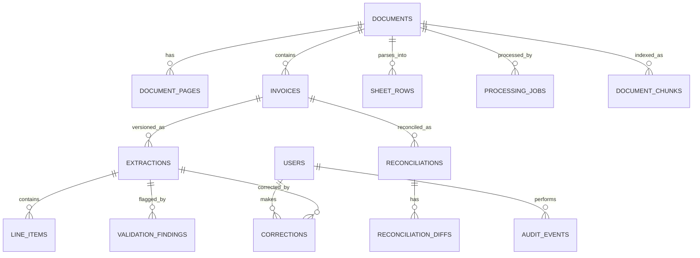

# Database schema — DocIntel

Implemented with SQLAlchemy 2.1 declarative models in `backend/app/models.py`.
Tables are created with `Base.metadata.create_all` (dev-friendly); on Postgres
the `pgvector` extension, a GIN full-text index, an HNSW vector index, and a
GIN index on sheet-row JSONB are ensured in `init_db`.

## Entity relationship (Mermaid)

## Tables and key columns

| Table | Purpose | Key columns |
|-------|---------|-------------|
| `users` | Auth + roles | `id` uuid PK, `email` unique, `name`, `password_hash`, `role` (admin/reviewer/viewer), `is_active`, `created_at` |
| `documents` | Physical uploaded file | `id`, `original_filename`, `storage_key`, `mime_type`, `kind` (pdf/image/spreadsheet), `size_bytes`, `sha256` unique, `status`, `stage`, `page_count`, `progress`, `error_code`, `error_message`, `uploaded_by`, `created_at`, `updated_at`, `deleted_at` |
| `document_pages` | Page text + OCR metadata | `id`, `document_id`, `page_number`, `text`, `text_source` (digital/ocr/none), `ocr_confidence`, `image_key`, `width`, `height`, `error`, unique (`document_id`, `page_number`) |
| `invoices` | Logical invoice units inside a file | `id`, `document_id`, `page_start`, `page_end`, `status`, `invoice_number_norm`, `supplier_norm`, `current_extraction_id`, `grouping_confidence`, `created_at`, `updated_at` |
| `extractions` | Immutable extraction revisions | `id`, `invoice_id`, `version`, `schema_version`, `prompt_version`, `model`, `source` (ai/manual/fallback), `data` jsonb, `confidence` jsonb, `review_status` (pending/approved), `reviewed_by`, `reviewed_at`, `review_note`, `created_by`, `created_at` |
| `line_items` | Queryable line items | `id`, `extraction_id`, `line_no`, `description`, `quantity`, `unit_price`, `amount`, `tax_rate`, `confidence`, `page` |
| `validation_findings` | Rule results (V001–V017) | `id`, `document_id`, `invoice_id`, `extraction_id`, `rule_code`, `severity` (info/warning/error), `field_path`, `message`, `expected`, `actual`, `status` (open/resolved/dismissed), `resolved_by`, `resolved_at`, `resolution_note`, `created_at` |
| `corrections` | Field-level audit trail | `id`, `extraction_id`, `user_id`, `field_path`, `old_value` jsonb, `new_value` jsonb, `reason`, `created_at` |
| `processing_jobs` | Durable job queue | `id`, `document_id`, `job_type`, `status` (queued/running/completed/failed/cancelled), `attempts`, `max_attempts`, `progress`, `error_code`, `error_message`, `locked_at`, `locked_by`, `started_at`, `finished_at`, `created_at` |
| `sheet_rows` | Parsed spreadsheet rows | `id`, `document_id`, `sheet_name`, `row_number`, `data` jsonb, `normalized` jsonb, `warnings` jsonb. `normalized.row_type` is `invoice` or `line_item`; invoice rows expose their merged child `line_items`, and line-item rows carry `parent_invoice_number` when linked. |
| `reconciliations` | Cross-document match | `id`, `invoice_id`, `matched_invoice_id`, `matched_document_id`, `sheet_row_id`, `match_type` (pdf_pdf/pdf_sheet), `confidence`, `status` (matched/mismatch/dismissed), `created_at` |
| `reconciliation_diffs` | Field differences | `id`, `reconciliation_id`, `field`, `invoice_value`, `sheet_value`, `severity` |
| `document_chunks` | Search + vectors | `id`, `document_id`, `page_id`, `invoice_id`, `chunk_index`, `content`, `embedding` (vector on Postgres / JSON on SQLite), `meta` jsonb |
| `audit_events` | Security/audit trail | `id`, `user_id`, `action`, `entity_type`, `entity_id`, `meta` jsonb, `ip`, `created_at` |

## Indexes

- `documents`: `sha256` unique, `status`, `created_at`, `kind`
- `document_pages`: unique (`document_id`, `page_number`)
- `invoices`: (`invoice_number_norm`, `supplier_norm`), `document_id`
- `extractions`: unique (`invoice_id`, `version`), (`invoice_id`, `review_status`)
- `processing_jobs`: claimed via `FOR UPDATE SKIP LOCKED` (Postgres) / status poll (SQLite)
- `sheet_rows`: (`document_id`, `sheet_name`), GIN on `normalized` (Postgres)
- `document_chunks`: GIN on `to_tsvector(content)` (Postgres), HNSW on `embedding vector_cosine_ops` (Postgres)
- `validation_findings`: (`document_id`, `status`), `rule_code`

## Data rules

- Money is stored as decimal strings inside extraction JSON (no float error).
- Original extraction JSON is immutable; corrections append a new immutable
  `extraction` revision linked to the prior one.
- Soft delete for documents (`deleted_at`); no hard purge in scope.
- Every status transition and review action writes an `audit_event`.
- Timestamps are UTC; API returns ISO 8601.

## Dev vs production

- Dev: `DATABASE_URL=sqlite:///./data/docintel.db` (local file). Embeddings use
  the deterministic hash fallback or FastEmbed stored as JSON.
- Production: `DATABASE_URL=postgresql+psycopg://...` (Supabase). `pgvector`
  extension, GIN FTS index, and HNSW vector index are created automatically on
  startup. `STORAGE_BACKEND=supabase` routes uploads to Supabase Storage.
